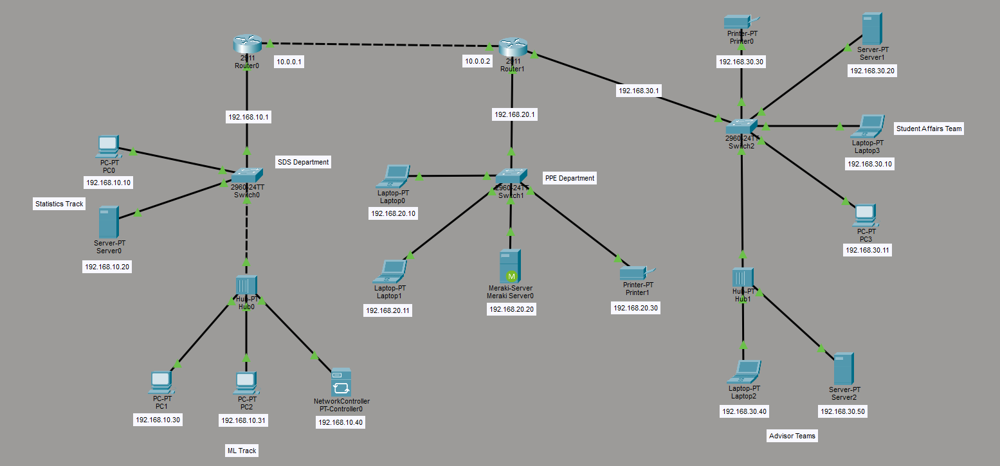

# Cisco Packet Tracer – Campus Network Simulation

## Project Overview

This project demonstrates the design and configuration of a small campus network using **Cisco Packet Tracer**. The network connects multiple academic departments and teams through routers, switches, and hubs, allowing devices in different subnets to communicate.

The simulation was independently designed and implemented as a hands-on exercise to strengthen my understanding of **computer networking, IPv4 addressing, subnetting, static routing, and network connectivity**.

## Network Topology



The network consists of three main local area networks (LANs), connected through two Cisco routers.

### Network Components

- **2 Cisco 2911 Routers** – Connect different networks and route traffic between them.
- **3 Cisco 2960 Switches** – Connect devices within departmental LANs.
- **2 Ethernet Hubs** – Connect additional devices within the same local network.
- **End Devices** – PCs, laptops, servers, printers, and a network controller.

### Departments and Teams

| Department / Team | Network | Connected Devices |
|---|---|---|
| SDS Department (Statistics & ML Tracks) | 192.168.10.0/24 | PCs, server, network controller |
| PPE Department | 192.168.20.0/24 | Laptops, Meraki server, printer |
| Student Affairs & Advisor Teams | 192.168.30.0/24 | PCs, laptops, servers, printer |

## IP Addressing and Subnetting

Each departmental LAN uses a separate `/24` subnet, while the two routers communicate through a `/30` point-to-point network.

| Network | Network Address | Subnet Mask | Default Gateway |
|---|---|---|---|
| SDS Department | 192.168.10.0/24 | 255.255.255.0 | 192.168.10.1 |
| PPE Department | 192.168.20.0/24 | 255.255.255.0 | 192.168.20.1 |
| Student Affairs & Advisors | 192.168.30.0/24 | 255.255.255.0 | 192.168.30.1 |
| Router-to-Router Link | 10.0.0.0/30 | 255.255.255.252 | N/A |

### Router IP Addresses

**Router0**
- LAN Interface: `192.168.10.1`
- Inter-router Interface: `10.0.0.1`

**Router1**
- Inter-router Interface: `10.0.0.2`
- PPE LAN Interface: `192.168.20.1`
- Student Affairs LAN Interface: `192.168.30.1`

## Network Configuration

### 1. IP Address Assignment

Static IPv4 addresses are assigned to the network devices according to their respective departmental subnets.

Each end device is configured with an IP address, subnet mask, and default gateway to support communication beyond its local network.

### 2. Static Routing

Static routing is used to establish communication between the three departmental networks.

**Router0 – Routes to PPE and Student Affairs**

```cisco
ip route 192.168.20.0 255.255.255.0 10.0.0.2
ip route 192.168.30.0 255.255.255.0 10.0.0.2
```

**Router1 – Route to SDS Department**

```cisco
ip route 192.168.10.0 255.255.255.0 10.0.0.1
```

These routes allow traffic to travel between the departmental LANs through the inter-router connection.

### 3. Ethernet Connectivity

The topology demonstrates different types of Ethernet connections, including:

- Router-to-router connectivity
- Router-to-switch connectivity
- Switch-to-end-device connectivity
- Switch-to-hub connectivity

The hubs extend connectivity to additional end devices within the existing LANs.

## Network Verification and Testing

The network can be verified using Cisco IOS commands and connectivity tests.

### Router Verification

```cisco
show ip interface brief
show ip route
```

### Connectivity Testing

Use the `ping` command to test communication between different departmental networks.

For example, from SDS PC0 (`192.168.10.10`):

```text
ping 192.168.10.1
ping 10.0.0.2
ping 192.168.20.10
ping 192.168.30.10
```

These tests check local gateway reachability, inter-router communication, and connectivity to devices in other subnets.

## Skills Demonstrated

- Designing a multi-department network topology
- Configuring Cisco routers and switches
- IPv4 addressing and subnetting
- Implementing static routing
- Understanding Ethernet connections
- Configuring default gateways
- Network verification and troubleshooting
- Working with Cisco Packet Tracer

## How to Run the Simulation

1. Install Cisco Packet Tracer.
2. Clone or download this repository.
3. Open `network/campus-network.pkt` in Cisco Packet Tracer.
4. Review the topology and device configurations.
5. Open the Command Prompt on an end device to run connectivity tests.
6. Use the router CLI to inspect interfaces and routing tables.

## Tools Used

- **Cisco Packet Tracer** – Network simulation and configuration
- **Cisco IOS CLI** – Router and switch configuration
- **GitHub** – Project documentation and version control

## Project Information

**Project Type:** Individual Hands-on Networking Exercise  
**Platform:** Cisco Packet Tracer  
**Routing Method:** Static Routing  
**Network Architecture:** Multi-LAN Campus Network

---

*This project was independently completed for practical learning and to demonstrate foundational computer networking skills.*